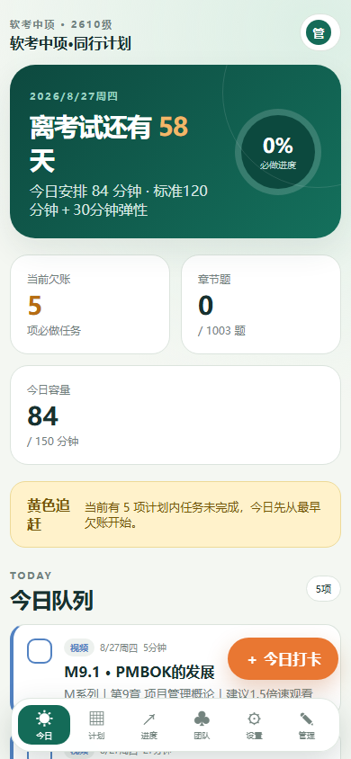
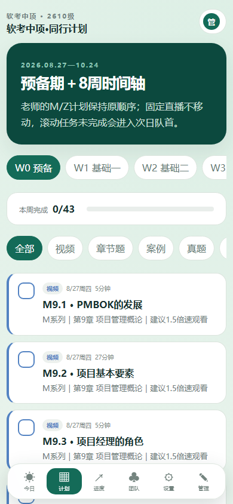
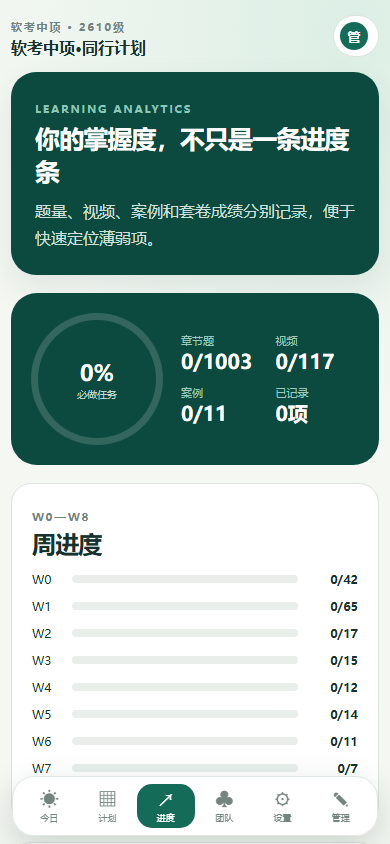
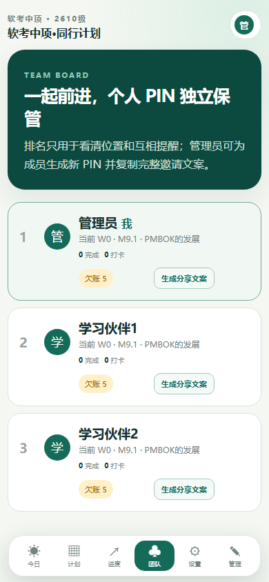
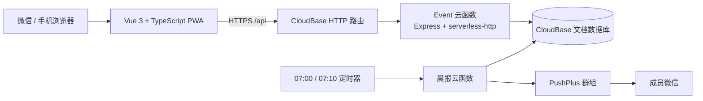

# Ruankao Team Study Tracker

> 面向「系统集成项目管理工程师」备考小组的移动端学习追踪站：把静态课程表变成会自动承接欠账、量化偏差并支持团队互助的执行系统。


[在线站点](https://ruankao-2026-d6g54aubh2bfed147-1475355522.tcloudbaseapp.com) · [部署指南](docs/deployment.md) · [架构与规则](docs/architecture.md)

> 在线站点仅向预建小组成员开放，仓库不提供真实团队口令、成员 PIN 或通知 Token。需要体验界面时请按「本地运行」使用公开演示账号。

## 为什么做这个项目

常见备考计划只告诉人“今天应该学什么”，却无法处理更真实的情况：今天没完成怎么办、直播能不能顺延、每个人落后多少、错题和套卷成绩如何回到复习计划里。

本项目将这些问题落成一套可执行规则：

- **欠账不会消失**：滚动任务未完成会进入次日队首，后续任务按容量重新排期。
- **基准不会漂移**：团队原计划保持不变，用“截至今天应完成但未完成的必做任务数”计算真实偏差。
- **固定节点不移动**：直播、考试等固定任务不因个人进度而顺延。
- **学习结果可复盘**：视频、题量、案例、套卷模式、用时、分数和错题标签分别记录。
- **小组协作不泄密**：成员只能在验证团队口令后出现，团队榜不显示 PIN；管理入口仅管理员可见。
- **国内访问链路简洁**：前端、云函数、文档数据库和定时任务集中在腾讯云 CloudBase。

## 页面预览

| 今日任务 | 计划时间轴 |
| --- | --- |
|  |  |

| 学习进度 | 团队进度 |
| --- | --- |
|  |  |

所有截图均来自本地演示数据，不包含真实成员、口令、PIN 或云端记录。

## 核心能力

### 学习计划

- 2026-08-27 开始，2026-10-23 完成新知识收口，2026-10-24 只保留考试节点。
- 预备期 W0 + 8 周计划，覆盖视频、章节题、案例、真题、模考、直播、错题和追赶八类任务。
- 老师原始计划中的 M 系列 78 段（851.5 分钟）和 Z 系列 23 段（288.5 分钟）保持顺序与日期边界。
- 视频用时按原时长 ÷ 1.5 折算；日常容量 120 分钟，并预留最多 30 分钟弹性区。
- 1003 道章节题、5 套近期真题、2 套模拟卷、直播 1–5 回放和直播 6–10 固定节点进入统一任务模型。

### 今日执行与进度

- 首页展示考试倒计时、今日队列、首个未完成任务、欠账数量、今日直播和下一任务。
- 周日优先清理欠账与复盘错题，未清零部分继续带入下一周。
- 章节题按实际题量记录；案例和套卷记录用时、模式与分数。
- 完整套卷支持连续计时或拆分完成；50/75 及以上显示绿色目标，45/75 以下标红。
- 进度页包含 W0–W8 周进度、题量、视频、案例、成绩趋势、错题标签和 28 天打卡热力图。

### 团队与权限

- 登录流程为“团队口令 → 成员身份 → 个人 6 位 PIN”。验证口令前不会返回成员名单。
- 团队口令和 PIN 使用随机盐 + `scrypt` 哈希保存；设备会话有效期 30 天。
- 管理员可新增成员、随机生成或重置 PIN、生成包含登录步骤的单人邀请文案。
- 团队页展示当前位置、完成任务数、欠账数、打卡天数和最近成绩，但不返回或展示任何 PIN。
- 管理员可增删改任务、导入/导出计划 JSON，并发起通知测试。

### PWA 与通知

- 适配微信内置浏览器和手机窄屏，可添加到桌面。
- 缓存应用壳与最近计划快照；断网操作进入队列，恢复网络后自动同步。
- CloudBase 定时函数每日 07:00 生成团队晨报，07:10 仅在首次失败时重试。
- PushPlus Token 与 Topic 只保存在云函数环境变量；群组晨报不包含 PIN、Token 或个人备注。

## 技术架构



数据库不允许前端直接读写；业务请求统一经过 `/api` 的团队验证、会话校验与角色授权。更完整的数据模型、排期规则和接口说明见 [docs/architecture.md](docs/architecture.md)。

## 本地运行

环境要求：Node.js 20+、npm 10+。

```powershell
git clone git@github.com:haiying-ai/ruankao-team-study-tracker.git
cd ruankao-team-study-tracker
Copy-Item .env.example .env.local
npm install
npm run dev
```

未设置 `VITE_API_BASE` 时会自动进入浏览器本地演示模式：

- 团队口令：`demo2026`
- 管理员身份：`管理员`
- 管理员 PIN：`123456`
- 两位学习伙伴 PIN：`111111`、`222222`

演示数据保存在浏览器 `localStorage`，不会连接或修改线上数据库。若需重置演示数据，清理该站点的本地存储即可。

## CloudBase 部署

仓库采用“首次基础设施配置”和“日常代码发布”分离的方式，避免每次发布重复修改路由、权限、环境变量或定时器。

日常发布先做零写入演练：

```powershell
npm install
powershell.exe -NoProfile -ExecutionPolicy Bypass `
  -File scripts/deploy-cloudbase.ps1 -Target All -PlanOnly
```

演练通过后，只部署本次改动涉及的最小目标：

```powershell
# Api / Notification / Frontend / All
powershell.exe -NoProfile -ExecutionPolicy Bypass `
  -File scripts/deploy-cloudbase.ps1 -Target Frontend
```

脚本会执行类型检查、自动测试和构建；云函数先在项目盘内打成小型 ZIP，再无交互上传；所有命令带硬超时，并通过远端修改时间、函数状态或静态资源哈希验证结果。部署工作区、日志和回退包均留在项目所在盘，减少系统盘临时目录暴增。

首次创建 CloudBase 环境、选择文档数据库、初始化成员/计划、配置 `/api` 路由、Rego 限定策略和晨报通知的完整步骤见 [docs/deployment.md](docs/deployment.md)。

## 质量检查

```powershell
npm run typecheck
npm test
npm run build
node --check functions/api/index.js
node --check functions/daily-notification/index.js
```

自动测试覆盖 M/Z 数量与时长、1003 道章节题、1.5 倍速折算、真题/模考数量、固定直播、考前截止、周日追赶、滚动队列和偏差计算。

## 项目结构

```text
ruankao-team-study-tracker/
├─ src/
│  ├─ data/plan.ts             # 完整学习计划与统计口径
│  ├─ services/api.ts          # 云端 API、本地演示、缓存与离线队列
│  ├─ stores/app.ts            # 会话和全局学习状态
│  └─ views/                   # 今日、计划、进度、团队、设置、管理
├─ functions/
│  ├─ api/                     # 登录、任务、团队和管理员接口
│  └─ daily-notification/      # 晨报生成、发送、失败日志与重试
├─ scripts/
│  ├─ initialize-cloudbase.ps1 # 安全输入首次口令/PIN并初始化
│  ├─ configure-pushplus.ps1   # 安全配置通知环境变量和定时器
│  └─ deploy-cloudbase.ps1     # 有界、可验证的增量部署
├─ tests/                      # 计划与滚动规则验收
├─ deploy/                     # 不含秘密的部署目标配置
└─ docs/                       # 架构、部署说明与公开截图
```

## 数据与隐私

仓库只包含公开演示凭据。真实团队口令、个人 PIN、CloudBase 一次性初始化 Token 和 PushPlus Token 不应写入 `.env.production`、脚本、截图、Issue 或提交历史。若秘密曾出现在公开位置，应立即在对应平台重置，而不是仅从最新提交中删除。

当前线上环境属于小组备考用途，CloudBase 默认域名与免费/体验额度不等同正式业务 SLA。考试日期、批次与考点最终以准考证和官方通知为准。

## 适用场景

当前数据为软考中项备考计划，但任务类型、滚动排期、团队偏差和成绩记录模型可复用于读书会、证书考试、训练营或小型学习小组。替换 `src/data/plan.ts` 和站点配置即可构建新的周期计划。
