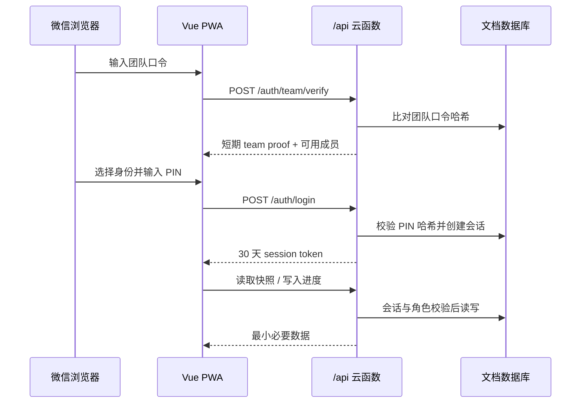

# 架构、数据模型与任务规则

## 1. 设计边界

该项目服务 2–10 人的小型备考团队，优先解决手机端执行、成员进度透明、任务欠账承接和国内网络可用性。它不是通用教务系统，也不保存课程视频或题库正文；任务中的资料链接指向团队已有的合法学习资料。

## 2. 请求与数据流



关键安全约束：

1. 团队口令验证成功前不返回成员列表。
2. 前端不持有数据库 SDK 写权限，所有业务操作经过云函数。
3. 团队口令与 PIN 使用独立随机盐的 `scrypt` 哈希；服务端不保存明文。
4. 管理接口要求 `admin` 角色；前端隐藏入口只是体验优化，真正授权仍由服务端完成。
5. 团队快照不返回 PIN 哈希、初始化 Token、通知 Token 或私密备注。

## 3. 核心集合

| 集合 | 作用 | 关键内容 |
| --- | --- | --- |
| `members` | 预建成员及权限 | 显示名、角色、启用状态、PIN 哈希与盐 |
| `plan_tasks` | 团队基准计划 | 顺序、日期、固定/滚动、类型、阶段、题量、时长、资料链接 |
| `completions` | 个人任务进度 | 完成/部分完成、实际题量、实际分钟、完成时间 |
| `checkins` | 每日打卡 | 成员、日期、学习分钟、备注 |
| `exam_attempts` | 真题与模考 | 模式、用时、选择/案例分数、错题标签 |
| `sessions` | 设备会话 | 随机令牌哈希、成员、过期时间 |
| `app_config` | 全局配置 | 团队口令哈希、站点名、考试日、环境到期日 |
| `notification_logs` | 晨报可观测性 | 发送批次、状态、失败原因、重试结果 |

错题标签目前嵌入 `exam_attempts`，便于按套卷回溯；当标签规模或协作需求增长时，可再拆分独立集合。

## 4. PlanTask 模型

每项计划至少包含以下语义：

- `sequence`：团队计划中的稳定顺序。
- `plannedDate`：基准计划日期，用于偏差计算，不因个人欠账改变。
- `schedulePolicy`：`rolling` 可顺延，`fixed` 始终留在原日期。
- `weekIndex` / `phase`：W0–W8 与基础、强化、模考等阶段。
- `type`：视频、章节题、案例、真题、模考、直播、错题、追赶。
- `originalMinutes` / `adjustedMinutes`：原始时长及 1.5 倍速折算时长。
- `questionCount`、`courseSeries`、`chapter`、`resourceUrl`、`required`。

## 5. 滚动排期

```text
今日队列 = 已到期且未完成的滚动必做任务
         + 今天的固定任务
         + 未超出 120 分钟常规容量的后续滚动任务
         + 最多 30 分钟弹性任务
```

- 未完成滚动任务保持原 `sequence`，次日仍排在队首；不会把完成状态伪装成延期。
- 固定直播和考试按原日期出现，不被欠账挤走。
- 周日优先展示追赶与错题复盘任务。
- 团队基准日期永远不改，个人界面只计算“实际执行队列”。

## 6. 偏差口径

```text
欠账数 = 截至今天应完成、required=true、但该成员尚未完成的任务数
```

- 欠账 0：才继续计算领先任务数。
- 欠账 3–6：黄色追赶提醒。
- 欠账 ≥ 7：红色提醒。
- 团队页按完成数量展示学习位置，但不将排名设计为奖惩机制。

这个口径避免了“把任务日期整体向后改，于是看起来人人都没落后”的假象。

## 7. API 边界

主要接口分为四组：

- 认证：团队口令验证、登录、退出。
- 学习：快照、任务完成/撤销、打卡、题量与成绩录入。
- 团队：成员进度摘要。
- 管理：任务增删改、成员与 PIN、计划 JSON 导入导出、通知测试。

远程模式使用同源 `/api`；本地演示模式由 `src/services/api.ts` 提供相同接口语义，因此页面无需维护两套业务逻辑。

## 8. 离线与一致性

- Service Worker 缓存应用壳，最近一次成功快照保存在浏览器。
- 写操作离线时进入本地队列；联网后按原顺序重放。
- 服务端仍是最终事实来源，客户端缓存不具备越权能力。
- 固定任务、偏差和团队数据依赖服务器日期口径，恢复联网后以新快照校准。
